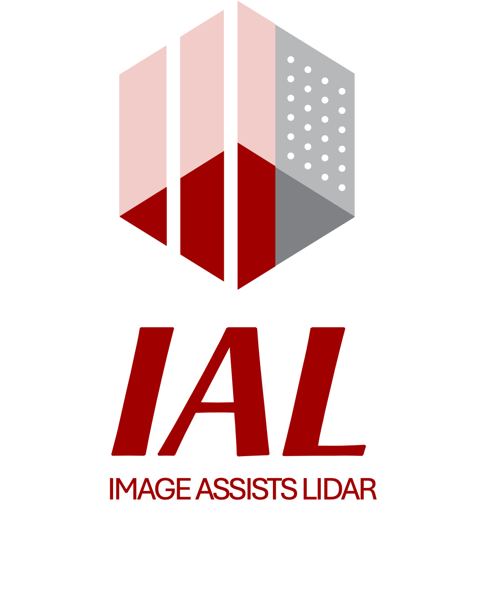
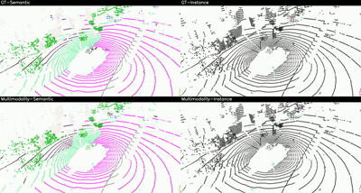
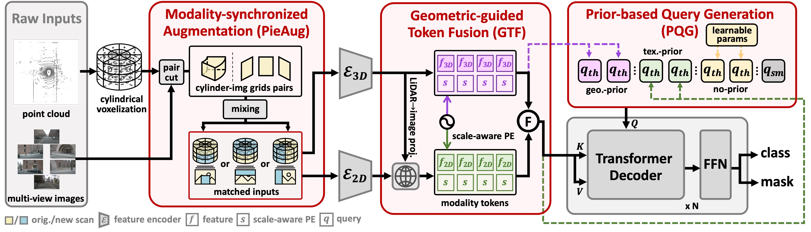
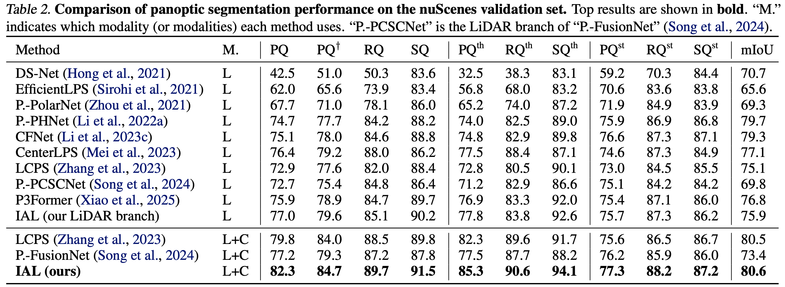
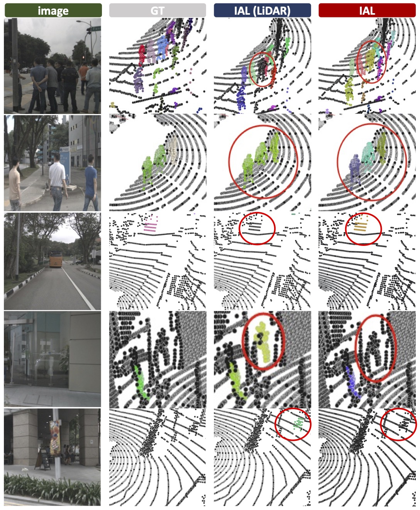
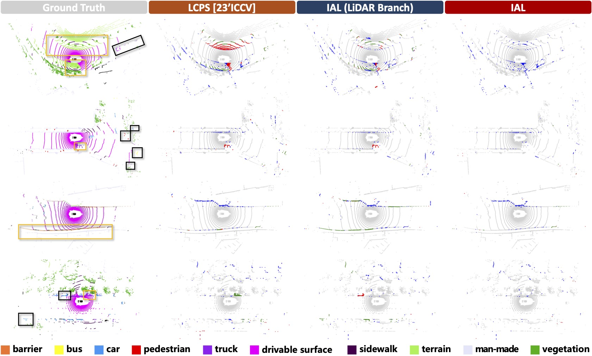

<p align="center">

<p>

# 🔥How Do Images Align and Complement LiDAR? Towards a Harmonized Multi-modal 3D Panoptic Segmentation
🥳*Accepted at ICML 2025*🥳

IAL is a novel multi-modal framework for LiDAR-camera 3D panoptic segmentation. To address misalignment and weak fusion, IAL designs a synchronized augmentation (PieAug) and a geometric-guided fusion module (GTF) to align LiDAR and image features. Moreover, it leverages complementary priors from both modalities as queries through PQG for stronger instance prediction. On nuScenes, IAL achieves 82.3% PQ, and on SemanticKITTI, it obtains 63.1% PQ, significantly surpassing previous methods.

## Demo




## Framework Diagram



## Preparation

### Environments  
Python == 3.8 \
CUDA == 11.1 \
pytorch == 1.10.1 \
mmcv == 2.0.0rc4 \
mmdet == 3.0.0 \
mmdet3d == 1.1.0 \
torch-scatter == 2.0.9 \
[nms_lib](https://github.com/GangZhang842/CFNet/tree/master/pytorch_lib)
*Please see install.sh for more details.

### Data Structure
Follow the [mmdet3d](https://github.com/open-mmlab/mmdetection3d/blob/master/docs/en/data_preparation.md) to process the nuScenes dataset.

```bash
data/nuscenes_full/
├── gsam # save 2d proposals
├── lidarseg
├── maps
├── nuscenes_infos_test.pkl
├── nuscenes_infos_train.pkl
├── nuscenes_infos_val.pkl
├── panoptic
├── samples
├── sweeps
├── v1.0-trainval
```
You can generate *.pkl by excuting
```bash
python tools/create_data.py nuscenes --root-path data/nuscenes_full --out-dir data/nuscenes_full --extra-tag nuscenes
```

### 2D proposal Generation
```bash
# setup for Grounding-DINO
cd tools
git clone https://github.com/IDEA-Research/GroundingDINO.git
cd GroundingDINO
pip install -e .
# infer & save results
3-infer-gsam.sh
```

*Checkpoints and 2D preprocessing data are available [here](https://huggingface.co/SigridPan/IAL).

## Train & Inference
```bash
# train
sh 1-train.sh
# inference
sh 2-val.sh 
```

## Main Results


## Visualization Results
Instance predictions on LiDAR and corresponding images.

Error maps.


## Citation
If you find this project helpful in your research, please consider **citing** our paper:
```bibtex   
@inproceedings{pan2025ial,
      title={How Do Images Align and Complement LiDAR? Towards a Harmonized Multi-modal 3D Panoptic Segmentation}, 
      author={Yining Pan and Qiongjie Cui and Xulei Yang and Na Zhao},
      booktitle = {Proceedings of the 42st International Conference on Machine Learning},
      year={2025},
      series = {ICML'25}
}
```

## Acknowledgement

Many thanks to the following awesome open-source projects!

Closely Relevant Projects:

- [LCPS](https://github.com/zhangzw12319/lcps)
- [P3Former](https://github.com/OpenRobotLab/P3Former)

Other Awesome Projects:

- [Grounding DINO](https://github.com/IDEA-Research/Grounded-Segment-Anything)
- [Segment Anything Model](https://github.com/facebookresearch/segment-anything)
- [nuScenes-devkit](https://github.com/nutonomy/nuscenes-devkit)
